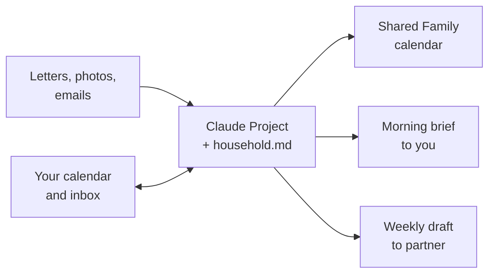

# AI Family Assistant

**A Claude Project that takes the mental load out of running a family.**

It reads your calendar and inbox, files nursery and school letters into the calendar, flags clashes before they bite, keeps an eye on how full your week is, and sends your partner a weekly heads-up on who's doing what.

No code, no app to install, no subscriptions beyond Claude. About 30 minutes to set up, and Claude walks you through it.

---

## What it does

| | |
| --- | --- |
| 📅 **Keeps one family calendar** | Files term dates, closures, appointments and clubs into a shared Family calendar both adults can see |
| 📸 **Reads letters and screenshots** | Photograph a nursery letter, say "file this", and the dates go in the calendar |
| 🚸 **Covers every drop-off and pick-up** | Makes sure each run has a named adult, and says what goes in the bag |
| ☀️ **Morning brief** | Daily summary on your phone: who's doing the runs, today's events, clashes coming up |
| ✉️ **Weekly partner summary** | Drafted email to your partner with the week ahead and a "needs from you" list. You approve before it sends |
| ⚽ **Plans around sport and socials** | Looks up season ticket fixtures and flags solo-parent days |
| 🧭 **Load check** | Notices when your week is overloaded or there's no time for you, and suggests ways to share the load |
| 💼 **Works for self-employed parents** | Protects working hours, flags closures that cost income, reminds you of tax deadlines |
| 📂 **Weekly folder check** | Spots school documents that haven't made it into the calendar |

## How it works

- **The brain** is a Claude Project with [`project-instructions.md`](project-instructions.md) and a `household.md` file describing your family.
- **The source of truth** is a shared Family calendar both adults subscribe to.
- **Nudges** arrive through your calendar and Claude's scheduled tasks, so they reach your phone.

## Quick start

**You'll need:** a paid Claude plan (Pro or Max), the Claude app on your phone and computer ([claude.ai/download](https://claude.ai/download)), and a Google or Microsoft calendar.

1. **Create a Project** in Claude: Projects → New Project.
2. **Paste the instructions.** Copy all of [`project-instructions.md`](project-instructions.md) into *Set project instructions* and save. No editing needed.
3. **Start a chat in the Project** and type **`start setup`**.
4. **Upload `household.md`** when Claude hands it to you at the end, using the **+** button on the Project page.

That's it. Setup asks one question at a time, checks your connections, and tells you exactly what to click if something's missing. Stop whenever you like: ask for "the file so far" and say **`continue setup`** later.

> **Coming from ChatGPT?** Run [`prompts/chatgpt-migration.md`](prompts/chatgpt-migration.md) in ChatGPT first, then paste the result in when setup starts.

## Which mail and calendar?

| You use | Connect in Claude | Shared calendar | School documents |
| --- | --- | --- | --- |
| Gmail / Google Calendar | Google Calendar, Gmail, Google Drive | Google calendar called `Family` | Google Drive |
| Outlook, Hotmail, Live, Microsoft 365 | Microsoft 365 | Outlook calendar called `Family` | OneDrive |
| iCloud, Yahoo or other | Google connectors on a free Google account just for the family | Google `Family` calendar, added to your phone | Google Drive |

No cloud storage? Upload documents straight into the Project instead.

## What setup asks about

1. What to call it, and how you like replies
2. What counts as time for yourself
3. Your mail, calendar and storage (it tests each connection)
4. The shared Family calendar
5. Both adults' work, including self-employed hours and tax deadlines
6. Your partner's sport and social commitments
7. Each child: nursery or school, run times, who does each, what goes in the bag, clubs
8. Term dates and closure days
9. House, health, pets, car, family and friends

It **won't** ask for dates of birth, medical details, ID or bank details. First names and school years are all it needs.

## Safety and privacy

This connects to your calendar and email, so it's built to be careful.

- 🔒 **Asks before acting.** Batches of events are listed for you to confirm.
- ✉️ **Drafts, never sends.** Every email is a draft for you to review.
- 👶 **Children's data stays yours.** Details stay in your own calendar, storage and Claude Project.
- 🚫 **No invented dates.** If it isn't in a document, your calendar or something you said, it asks or looks it up, and says which.
- 🙈 **Private stays private.** Health notes and "how you work best" never appear in anything your partner sees.
- 🧾 **No tax advice.** It reminds you of deadlines and points you to GOV.UK or your accountant.

**Before you connect anything:** only use official connectors, read the permission screen, keep "ask before acting" on, and turn on two-step verification for your email account.

**Never commit your filled-in `household.md`** to this or any repo. The `.gitignore` blocks it by default.

## Files

| File | What it's for |
| --- | --- |
| [`project-instructions.md`](project-instructions.md) | Paste into your Claude Project |
| [`templates/household-template.md`](templates/household-template.md) | What your household file contains (setup fills it in for you) |
| [`prompts/chatgpt-migration.md`](prompts/chatgpt-migration.md) | Bring your context over from ChatGPT |
| [`docs/full-guide.pdf`](docs/full-guide.pdf) | Full reference: options, scheduled tasks, privacy checklist |

## FAQ

**Can my partner use it too?**
On Pro or Max, a Project belongs to one account. Your partner sees everything through the shared Family calendar and the weekly email. If you both want to ask it things, each set up a copy pointing at the same Family calendar.

**Does it work on my phone?**
Yes. Setup is easier on a computer, but day to day you'll use the Claude phone app: photograph letters, check the brief, ask what's on.

**Can I use it for work too?**
Make a separate Project for work, so client details never end up in the family calendar or your partner's email.

**Something went wrong.**
Say so in the chat ("that's on the wrong day"). It'll fix it, and you can ask it to add the lesson to its instructions.

## Contributing

Ideas, fixes and lessons from your own family's setup are welcome. Open an issue or a pull request. Please never include real household data.

## Licence

[MIT](LICENSE). Use it, adapt it, share it; just keep the copyright notice.

## Support

If this saves you a few school-run headaches, you can buy me a coffee:

---

*Built with [Claude](https://claude.ai). Not affiliated with or endorsed by Anthropic.*
